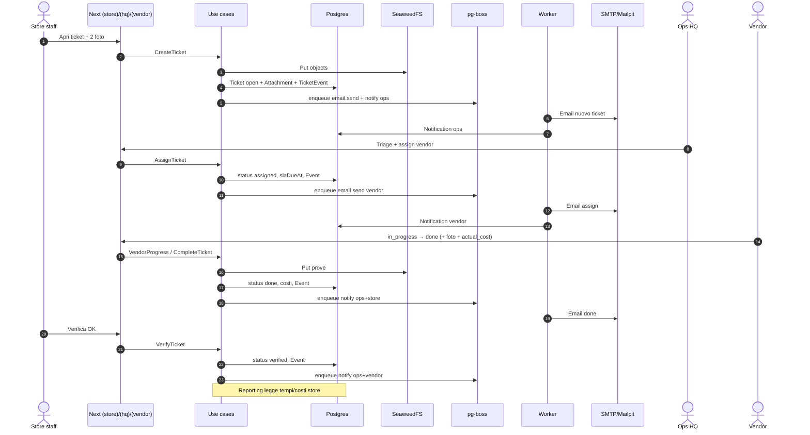
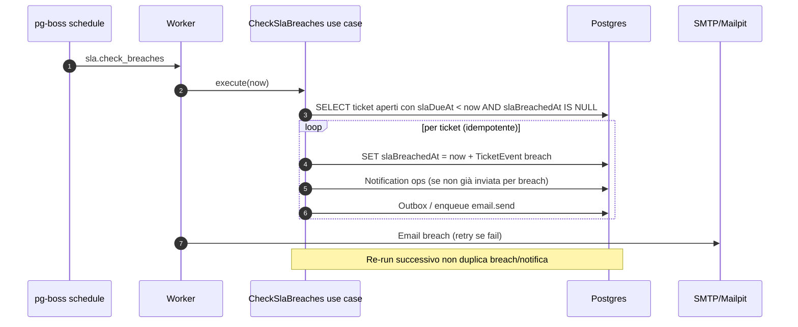

# FacilityFlow Retail — Software Architecture

> **Ruolo:** documento di architettura software (AR).  
> **Vincoli:** OSS-only / self-host — [`docs/product/STACK.md`](../product/STACK.md).  
> **Scope prodotto:** [`docs/product/BACKLOG.md`](../product/BACKLOG.md) · RBAC [`docs/product/RBAC.md`](../product/RBAC.md).  
> **Lingua:** italiano. **Nessun codice applicativo** in questo file — solo decisioni, confini e pattern.  
> **Stato:** Accepted — **implementato lab S1–S5** (2026-10-29). Production Go = gap VPS [`../product/sprints/S5-EXIT-GAPS.md`](../product/sprints/S5-EXIT-GAPS.md).

---

## 1. Analysis Card

| Campo | Contenuto |
|-------|-----------|
| **Assunzioni** | Greenfield Next.js App Router; un solo monorepo app+worker; Postgres è System of Record; SeaweedFS solo blob; Auth.js sessioni DB-backed; multi-tenant single-region EU; UI IT; production-ready = epic **E14 / S5**, non CMMS enterprise. |
| **Ricerca** | Clean/Hexagonal su Next App Router: route/Server Actions come adapter sottili, dominio senza framework ([AverageDevs Clean Architecture fullstack](https://www.averagedevs.com/blog/clean-architecture-fullstack), [Hexagonal ports/adapters](https://alistair.cockburn.us/hexagonal-architecture/), [Clean Architecture](https://blog.cleancoder.com/uncle-bob/2012/08/13/the-clean-architecture.html)). Stack OSS già locked in `STACK.md` (Auth.js, Prisma, Postgres, SeaweedFS, pg-boss, Nodemailer). Outbox + job su Postgres evita Redis obbligatorio in MVP. |
| **Scelta di design** | **Backend-in-Next** (composition root in Server Actions / route handlers) + **processo `worker` separato** che importa gli stessi use case di dominio; layer `domain → application → adapters`; folder `src/` condivisa. Alternativa scartata: microservizi o monorepo multi-package prematuro (overhead senza team/scaling). Alternativa scartata: Event Sourcing pieno (TicketEvent append-only basta per audit). |
| **AI** | `later` — Fase 2 Ollama locale + conferma umana; mai SoR (stato ticket, SLA, permessi restano dominio deterministico). |
| **Rischi** | Leak cross-tenant se `tenantId` client-trusted; fat client che bypassa use case; worker e app con drift di regole; SeaweedFS/signed URL mal configurati; scope S1 XL. Mitigazioni: helper repository obbligatori, test isolamento, stessa libreria dominio, DoD + verify compose. |

---

## 2. Goals & non-goals

### Goals

- Essere il **System of Record** multi-tenant per manutenzione retail/franchise (wedge: intake → ticket/SLA/dispatch → costi per store).
- Isolamento tenant rigoroso e RBAC per ruoli MVP (`owner` … `viewer_finance`).
- Stack **100% OSS self-host** via Docker Compose (app, worker, postgres, seaweedfs, mailpit/dev).
- Increment potenzialmente rilasciabile per sprint; **production-ready pilota** solo con **E14** (harden, ops, TLS, backup, exit S5).
- Dominio testabile senza Next/Prisma; adapter sostituibili.

### Non-goals

- CMMS enterprise (PM calendar completo, BOM, warehouse, IoT, multi-paese, marketplace, pagamenti/escrow).
- WhatsApp Business API a pagamento come SoR; AI chatbot sostitutivo ops.
- SaaS a pagamento nel path critico (Clerk, Neon/Supabase Cloud, R2/S3 paid, Resend/Postmark, Inngest Cloud, Sentry Cloud).
- Microservizi, Kafka, Redis obbligatorio, Event Sourcing completo in MVP.
- App native; billing/abbonamenti SaaS prodotto.

---

## 3. Bounded contexts

Contesti delimitati (linguaggio ubiquo allineato al backlog). Comunicazione preferita: **chiamate sincrone in-process** tra application services nello stesso deploy; eventi di dominio / outbox solo dove serve affidabilità verso SMTP o job.

| Contesto | Responsabilità | Aggregati / concetti chiave | Dipendenze tipiche |
|----------|----------------|-----------------------------|--------------------|
| **Tenancy / Identity** | Tenant, signup, sessione Auth.js, Membership, ruoli, invite, reset password | `Tenant`, `User` (identità), `Membership`, InviteToken | Auth.js, Postgres |
| **Network / Catalog** | Rete punti vendita, vendor, coverage, asset registry leggero | `Store`, `Vendor`, `Asset` | Tenancy (scope) |
| **Ticketing / SLA** | Lifecycle ticket, allegati meta, policy SLA, breach, costi su ticket | `Ticket` (+ events, attachments), `SlaPolicy` | Catalog (store/vendor/asset), Tenancy |
| **Notifications** | Email outbox, in-app notification, bell | `Notification`, EmailOutbox (infra) | Ticketing (trigger), SMTP, pg-boss |
| **Reporting** | Dashboard HQ, aggregati costi/MTTR (read model pragmatico) | Query read-only su ticket/store | Ticketing (read), RBAC `viewer_finance` |

**Context map (semplificata):** Tenancy → (autorizza) tutti; Catalog ← Ticketing; Ticketing → Notifications; Reporting ← Ticketing (lettura).

Non introdurre bounded context separati per “Attachment Storage” o “Jobs”: sono **adapter** (SeaweedFS, pg-boss) al servizio dei contesti sopra.

---

## 4. Hexagonal / Clean — layer e dependency rule

```
┌─────────────────────────────────────────────────────────────┐
│  Adapters (driving)                                         │
│  App Router UI · Server Actions · Route handlers · Worker   │
└───────────────────────────┬─────────────────────────────────┘
                            │ chiama
┌───────────────────────────▼─────────────────────────────────┐
│  Application (use cases / orchestration)                    │
│  porte in ingresso; dipende da porte in uscita (interfaces) │
└───────────────────────────┬─────────────────────────────────┘
                            │ usa
┌───────────────────────────▼─────────────────────────────────┐
│  Domain                                                     │
│  aggregati, VO, invarianti, policy di stato, errori dominio │
│  ZERO import Next / Prisma / SeaweedFS / Nodemailer         │
└───────────────────────────▲─────────────────────────────────┘
                            │ implementa porte
┌───────────────────────────┴─────────────────────────────────┐
│  Adapters (driven) — infrastructure                         │
│  Prisma repos · SeaweedFS signed URL · SMTP · Auth.js       │
│  pg-boss enqueue/consume · clock / id generators            │
└─────────────────────────────────────────────────────────────┘
```

**Dependency rule:** le dipendenze sorgente puntano **verso l’interno**. Domain non conosce framework. Application dipende solo da Domain + porte. Infrastructure e HTTP/UI dipendono da Application/Domain, mai il contrario.

**Composition root:** wiring concreto (Prisma client, storage, mailer, boss) ai bordi — `app/` (Server Actions / route) e bootstrap `workers/`.

---

## 5. Frontend architecture

| Principio | Decisione |
|-----------|----------|
| App Router | Route groups: `(auth)`, `(hq)`, `(store)`, `(vendor)` — layout e gate RBAC per superficie |
| RSC default | Server Components per liste/dettaglio; Client Components solo dove serve interattività |
| Mutation | Preferire **Server Actions**; Route handlers per health, webhook/futuri, download signed, Auth.js |
| UI kit | shadcn/ui + Tailwind condivisi in `components/ui` + componenti dominio IT in `components/` |
| Stato client | **No** store globale grasso; eccezione: **campanella notifiche** (unread count / poll o refresh leggero) |
| i18n MVP | Copy italiano inline / keys minime; niente multi-locale finché E10 non lo richiede |
| Phone-first | Store e vendor pensati mobile; HQ desktop-first ma responsive |

Gate: layout di gruppo legge sessione + Membership; deny → redirect/403 IT. Nessuna logica di stato ticket nei componenti — solo invocazione use case.

---

## 6. Backend-in-Next + worker pg-boss

```
┌──────────────┐     same domain/application imports      ┌──────────────┐
│  Next app    │◄────────────────────────────────────────►│   worker     │
│  (HTTP/RSC)  │                                          │  (pg-boss)   │
└──────┬───────┘                                          └──────┬───────┘
       │ Prisma / enqueue jobs                                   │ consume
       └──────────────────── Postgres (+ boss tables) ───────────┘
                                    │
                              SeaweedFS / SMTP
```

- **App:** driving adapter HTTP/UI; enqueue job (`sla.check_breaches`, `email.send`, opz. `gdpr.purge`) dopo commit transazionale (pattern outbox).
- **Worker:** processo Node separato in Compose; **nessuna duplicazione** delle regole di business — importa use case da `src/application` e adapter da `src/infrastructure`.
- Un solo schema Prisma; migrazioni applicate da app o job di init documentato in ops.

---

## 7. Multi-tenant enforcement

1. **`tenantId` nella sessione** (JWT/session Auth.js arricchita da Membership attiva) — fonte di verità per lo scope corrente.
2. **Repository helpers** obbligatori: ogni query/mutation di dominio riceve `TenantContext { tenantId, userId, role, storeIds?, vendorId? }` e applica `WHERE tenant_id = …` (+ store/vendor scope).
3. **Mai fidarsi** di `tenantId` (o storeId/vendorId elevati) dal body/query client: usare solo sessione + membership; ID risorsa verificati appartenere al tenant.
4. Soft-delete e export GDPR sempre scoped al tenant.
5. Test automatici isolamento (tenant A non legge B) su store/ticket/asset/membership — DoD.

---

## 8. Struttura cartelle suggerita (`src/`)

```
src/
  domain/                 # aggregati, VO, errori, policy puro
    tenancy/
    catalog/
    ticketing/
    notifications/
    shared/               # Money, Priority, Result types, …
  application/            # use cases + porte (interfaces)
    tenancy/
    catalog/
    ticketing/
    notifications/
    reporting/
  infrastructure/         # adapter driven
    prisma/               # client, mappers, repos
    seaweedfs/
    mail/
    auth/                 # Auth.js adapter glue (non regole RBAC di dominio)
    jobs/                 # enqueue pg-boss
    clock/
  app/                    # Next App Router (oppure root `app/` Next convention)
    (auth)/
    (hq)/
    (store)/
    (vendor)/
    api/                  # health, auth routes, signed download se serve
  components/             # UI condivisa + feature presentational
    ui/
    …
  workers/                # entrypoint processo worker + handler job
prisma/                   # schema + migrations (repo root tipico)
```

Nota: se il progetto Next colloca `app/` a root, mantenere comunque `src/domain|application|infrastructure|workers|components` e tenere `app/` sottile.

---

## 9. Aggregate sketch

| Aggregato | Root | Contenuto / invarianti chiave | Note |
|-----------|------|-------------------------------|------|
| **Tenant** | `Tenant` | name, slug, region=`EU`, active flag | Disattivazione, non soft-delete |
| **Membership** | `Membership` | tenantId, userId, role, storeIds[] (null = HQ all), vendorId? | Scope RBAC; soft-delete |
| **Store** | `Store` | anagrafica, timezone, contatti | Soft-delete; deleted → no nuovi ticket |
| **Vendor** | `Vendor` | trades, coverage storeIds, contatti | Soft-delete; invite utente `vendor` |
| **Asset** | `Asset` | storeId, category, label, preferredVendorId? | Soft-delete; scope store |
| **Ticket** | `Ticket` | status machine, priority, category, vendorId?, slaDueAt, costi, timestamps | Soft-delete raro; **transazioni** sullo root |
| ↳ eventi | `TicketEvent` | append-only, actor, from/to, meta | **Non** soft-delete; audit |
| ↳ allegati | `Attachment` | storageKey, mime, size, uploader | Blob in SeaweedFS; meta in PG |
| **SlaPolicy** | `SlaPolicy` | category × priority → resolutionHours | Seed default S1; CRUD completo S2 |
| **Notification** | `Notification` | userId, type, ticketId?, payload, readAt | Soft-delete; bell unread |

**Identità utente (`User`)** vive con Auth.js (credential/session); Membership è il ponte tenant↔ruolo.  
**EmailOutbox / Session / Account / InviteToken:** infrastruttura, non linguaggio di prodotto.

Stati ticket (MVP):  
`open → triaged → assigned → in_progress → waiting_parts → done → verified` | `cancelled`  
(invarianti e permessi in dominio + matrice RBAC).

---

## 10. Cross-cutting

| Concern | Pattern |
|---------|---------|
| **Email affidabile** | Outbox: scrive intent email in PG (o job pg-boss) **nella stessa transazione** del cambio stato; worker `email.send` con retry/backoff; Mailpit in dev |
| **Audit** | `TicketEvent` **append-only**; nessuna update/delete di business; meta JSON per assign/costi/note |
| **Allegati** | Upload via API S3-compatible SeaweedFS; Postgres tiene solo metadata; **signed URL** a scadenza per download; MIME allowlist + max size |
| **SLA** | Calcolo `slaDueAt` a triage/assign da `SlaPolicy`; job periodico `sla.check_breaches`; idempotenza un `slaBreachedAt` + una notifica breach finché non resolved |
| **Security** | Cookie httpOnly, CSRF-safe mutation, rate limit login/signup, secret solo env, no SaaS |
| **Observability MVP** | Log JSON strutturati; GlitchTip/Loki opzionali (profile) |
| **GDPR** | Export/retention (E12); purge job opzionale su pg-boss |

---

## 11. Sequence diagrams (Mermaid)

### Flusso A — create → assign → done → verify



### Flusso B — SLA breach job



---

## 12. Testing strategy

| Livello | Cosa | Tooling (indicativo) |
|---------|------|----------------------|
| **Domain unit** | State machine ticket, calcolo SLA due, scope membership, deny transizioni illegali | Vitest/Jest — zero I/O |
| **Use-case integration** | Create/assign/verify + outbox enqueue; isolamento tenant | Postgres reale via **Testcontainers** (target post-S1 quando schema stabile); in S1 possibile PG Compose dedicato ai test |
| **RBAC matrix** | Deny/allow azioni critiche allineate a `RBAC.md` | Test tabellari per ruolo × azione |
| **Adapter smoke** | Signed URL SeaweedFS, SMTP → Mailpit, health | Compose profile `dev` + script verify |
| **E2E acceptance** | Flussi A/B/C (`E13`) | Manuale/cronometrato S1–S3; automazione se ROI chiaro in S4/S5 |
| **Non obiettivo MVP** | Coverage 100%; contract test microservizi | — |

Ogni story Done: AC + isolamento tenant + test dominio rilevante (DoD sprint).

---

## 13. Stato Increment (S1–S5)

| Sprint | Stato lab | Contenuto chiave |
|--------|-----------|------------------|
| **S1** | Done | Compose, Auth.js, tenancy/RBAC, store/vendor/asset, onboarding |
| **S2** | Done | Ticket FSM, allegati SeaweedFS, SLA due, deep link, email, Flusso A→assigned / C hard |
| **S3** | Done | Vendor portal, verify/costi, breach+relaunch, bell, Flusso A→verified / B |
| **S4** | Done | Dashboard HQ + `viewer_finance`, seed 15×5, soft-delete/i18n/security, GDPR; `US-E10-08` → F2-09 |
| **S5 / E14** | Lab PASS / **NO-GO VPS** | Caddy, compose prod, health live/ready, CI, runbook; gap host in `S5-EXIT-GAPS.md` |
| **Fase 2** | Deferred | Ollama, email-to-ticket, audit config membership (F2-09), … |

Indice operativo: [`../product/INCREMENT_STATUS.md`](../product/INCREMENT_STATUS.md).

---

## Riferimenti

- Stack: [`docs/product/STACK.md`](../product/STACK.md)
- Backlog / epics: [`docs/product/BACKLOG.md`](../product/BACKLOG.md)
- RBAC: [`docs/product/RBAC.md`](../product/RBAC.md)
- Sprint backlog: [`docs/product/sprints/`](../product/sprints/)
- Ops prod: [`docs/ops/NEXT_VPS.md`](../ops/NEXT_VPS.md) · [`docs/ops/COMPOSE_PROD.md`](../ops/COMPOSE_PROD.md)
- DoD: [`docs/product/sprints/DEFINITION_OF_DONE.md`](../product/sprints/DEFINITION_OF_DONE.md)
- Hexagonal / Clean (fondamenti): [Cockburn](https://alistair.cockburn.us/hexagonal-architecture/), [Martin](https://blog.cleancoder.com/uncle-bob/2012/08/13/the-clean-architecture.html)

---

*Documento AR — aggiornare con ADR light se cambiano confini (es. split reporting DB, introduzione Valkey, cambio storage).*
