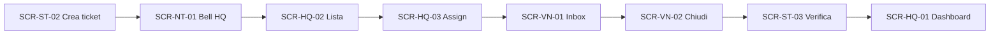
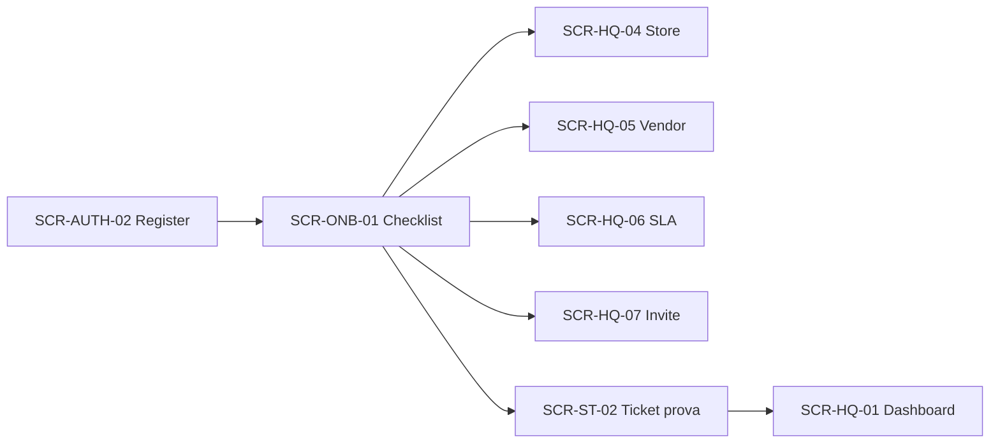

# FacilityFlow Retail — Information Architecture

> Sitemap e navigazione per ruolo. Allineata a RBAC (`docs/product/RBAC.md`) e Flussi A/C.  
> UI italiano · phone-first store/vendor · desktop HQ.

---

### Analysis Card

- **Assunzioni:** un tenant = un workspace; ruoli con shell diverse (non un’unica nav filtrata); deep-link kiosk rientra nello shell store.
- **Ricerca:** pattern SaaS multi-role 2026 = route groups per audience + RBAC server-side (shadcn sidebar HQ + bottom nav mobile ops). Fonte stack: [shadcn/ui](https://ui.shadcn.com/) come default componenti SaaS Next.
- **Scelta di design:** IA piatta (≤2 livelli) per store/vendor; HQ con sidebar 1 livello + dettaglio ticket come hub. Alternativa scartata: megamenu o “app switcher” multi-prodotto.
- **AI:** no.
- **Rischi:** overlap “Asset” vs ticket create — asset resta sotto Store HQ; in create-ticket è solo select opzionale.

---

## 1. Principi IA

1. **SoR chiaro:** il ticket è l’oggetto centrale (Flusso A); onboarding è percorso a checklist (Flusso C), non un prodotto separato.
2. **Scope = nav:** se l’utente non può mutare una risorsa, la voce è assente (non solo disabled).
3. **Phone ≤ 4 voci** bottom nav (store/vendor).
4. **URL leggibili** e deep-linkabili (`/tickets/[id]`, `/onboarding`).
5. **Notifiche (Bell)** = inbox eventi cross-schermata, non sostituto della lista ticket.

---

## 2. Pubblici e shell

| Audience | Ruoli | Shell | Breakpoint primario |
|----------|-------|-------|---------------------|
| **Pubblico** | anonimo | Marketing / Auth | Desktop + mobile |
| **HQ Ops** | `owner`, `admin_hq`, `ops_coordinator` | Sidebar + topbar | Desktop |
| **Finance view** | `viewer_finance` | Sidebar ridotta | Desktop |
| **Store** | `store_manager`, `store_staff` | Bottom nav + sticky CTA | Phone |
| **Vendor** | `vendor` | Bottom nav | Phone |

---

## 3. Sitemap per ruolo

### 3.1 Pubblico / Auth

```
/                         Landing (opz. MVP: redirect /login)
/login                    Accedi
/register                 Crea workspace (owner)
/forgot-password          Reset
/reset-password           Imposta nuova password
/invite/[token]           Accetta invito (set password + join tenant)
```

### 3.2 Onboarding (Flusso C) — post-auth HQ

```
/onboarding               Checklist guidata (progress persistito)
/onboarding/stores        Step store (crea / CSV)
/onboarding/vendors       Step vendor
/onboarding/sla           Step SLA default
/onboarding/invite        Step invita store manager
/onboarding/sample-ticket Step ticket di prova (gate hard S2)
```

Skip consentito con warning in Dashboard (AC `US-E02-04`).

### 3.3 HQ Ops

```
/app                      Redirect → /app/dashboard
/app/dashboard            KPI + SLA risk + empty→onboarding
/app/tickets              Lista triage (filtri)
/app/tickets/[id]         Dettaglio hub (timeline, assign, note, costi)
/app/stores               Elenco / CRUD / import CSV
/app/stores/[id]          Dettaglio store + membership hint
/app/vendors              Elenco vendor + coverage
/app/vendors/[id]         Dettaglio vendor
/app/assets               Inventario (filtro store)
/app/assets/[id]          Dettaglio asset
/app/settings             Tenant base, utenti/inviti, ruoli (owner/admin)
/app/settings/users       Inviti / membership
/app/settings/sla         Policy SLA
/app/notifications        Lista completa (opz.; Bell = popover)
```

**Fuori nav MVP:** billing, marketplace, PM calendar, WhatsApp hub.

### 3.4 Viewer finance

```
/app/dashboard            Aggregati costi / MTTR (read-only)
/app/tickets              Solo chiusi/verificati (+ costi)
/app/tickets/[id]         Read-only
```

Niente Store/Vendor CRUD, niente Assign.

### 3.5 Store

```
/s                        Home store (riepilogo aperti + CTA)
/s/tickets                I miei ticket (membership stores)
/s/tickets/new            Crea ticket (Flusso A start)
/s/tickets/[id]           Dettaglio + Verifica / Rifiuta se `done`
/s/notifications          (opz. full list)
/s/account                Profilo, store attivo (se multi), logout
```

Deep-link kiosk: `/s/tickets/new?storeId=…` (membership enforced).

### 3.6 Vendor

```
/v                        Redirect → /v/inbox
/v/inbox                  Ticket assegnati aperti
/v/inbox/[id]             Dettaglio + stati + chiudi (foto, costi)
/v/done                   Interventi chiusi (storico leggero)
/v/account                Profilo vendor, logout
```

---

## 4. Navigazione

### 4.1 HQ — Sidebar

| Voce | Route | Ruoli |
|------|-------|-------|
| Dashboard | `/app/dashboard` | HQ + finance |
| Ticket | `/app/tickets` | HQ + finance |
| Punti vendita | `/app/stores` | HQ ops |
| Fornitori | `/app/vendors` | HQ ops |
| Asset | `/app/assets` | HQ ops |
| Impostazioni | `/app/settings` | owner, admin_hq (ops: SLA read/write se AC) |

**Topbar:** switch contesto tenant (1 solo MVP) · search ticket ID (opz. S4) · **Bell** · menu utente.

### 4.2 Store — Bottom nav

| Voce | Route | Icona lucide |
|------|-------|--------------|
| Home | `/s` | `House` |
| Ticket | `/s/tickets` | `Ticket` |
| Apri | `/s/tickets/new` | `Plus` (emphasis) |
| Account | `/s/account` | `User` |

Bell in header (non quinta voce).

### 4.3 Vendor — Bottom nav

| Voce | Route | Icona |
|------|-------|-------|
| Inbox | `/v/inbox` | `Inbox` |
| Chiusi | `/v/done` | `CheckCheck` |
| Account | `/v/account` | `User` |

---

## 5. Schermate chiave (inventario MVP)

| ID | Schermata | Flusso | Priorità |
|----|-----------|--------|----------|
| SCR-AUTH-01 | Login | — | P0 |
| SCR-AUTH-02 | Register workspace | C setup | P0 |
| SCR-AUTH-03 | Accept invite | C | P0 |
| SCR-ONB-01 | Checklist onboarding | **C** | P0 |
| SCR-HQ-01 | Dashboard HQ | A coda / C empty | P0 |
| SCR-HQ-02 | Ticket list triage | **A** | P0 |
| SCR-HQ-03 | Ticket detail + assign | **A** | P0 |
| SCR-HQ-04 | Store list / CSV | C | P0 |
| SCR-HQ-05 | Vendor list | C | P0 |
| SCR-HQ-06 | SLA policies | C | P0 |
| SCR-HQ-07 | Users & invites | C | P0 |
| SCR-ST-01 | Store home | A | P0 |
| SCR-ST-02 | Create ticket + foto | **A** | P0 |
| SCR-ST-03 | Ticket detail + verify | **A** | P0 |
| SCR-VN-01 | Vendor inbox | **A** | P0 |
| SCR-VN-02 | Close job (foto+costo) | **A** | P0 |
| SCR-NT-01 | Bell popover / list | A/B | P0 |
| SCR-AS-01 | Asset CRUD | prep A | P1 |

Wireframe ASCII/mermaid: [`WIREFRAMES.md`](./WIREFRAMES.md).

---

## 6. Oggetti di navigazione secondari

### Ticket detail — tab / sezioni (HQ)

1. **Panoramica** — stato, SLA due/breach, store, priorità  
2. **Timeline** — `TicketEvent`  
3. **Note** — interne HQ vs vendor (RBAC)  
4. **Allegati** — foto SeaweedFS  
5. **Costi** — estimated/actual (scope ruolo)

### Filtri lista HQ (persistenza URL query)

`status`, `storeId`, `vendorId`, `priority`, `sla=risk|breached`, `from`, `to`

### Stati ticket (etichette IT UI)

| status | Label |
|--------|-------|
| `open` | Aperto |
| `triaged` | In triage |
| `assigned` | Assegnato |
| `in_progress` | In corso |
| `done` | Da verificare |
| `verified` | Verificato |
| `cancelled` | Annullato |

---

## 7. Mappa Flusso A → schermate



## 8. Mappa Flusso C → schermate



---

## 9. Notifiche — destinazioni deep-link

| Evento | Ruoli | Target route |
|--------|-------|--------------|
| Nuovo ticket | ops HQ | `/app/tickets/[id]` |
| Assign | vendor | `/v/inbox/[id]` |
| SLA breach | ops HQ | `/app/tickets/[id]?focus=sla` |
| Done | ops + store | HQ detail / `/s/tickets/[id]` |
| Verified / reject | ops + vendor | rispettivi detail |
| Invite | utente | `/invite/[token]` |

Regole complete: backlog E08.

---

## 10. Cosa non compare in nav (esplicito)

- WhatsApp / canali social come SoR  
- Calendario PM / preventive scheduling  
- Marketplace fornitori  
- Pagamenti / billing  
- Multi-country / multi-lingua UI (solo IT MVP)  
- AI chatbot  

---

## Riferimenti

- Design system: [`DESIGN_SYSTEM.md`](./DESIGN_SYSTEM.md)  
- Wireframe: [`WIREFRAMES.md`](./WIREFRAMES.md)  
- RBAC: [`../product/RBAC.md`](../product/RBAC.md)  
- Backlog Flussi: [`../product/BACKLOG.md`](../product/BACKLOG.md) E13  
