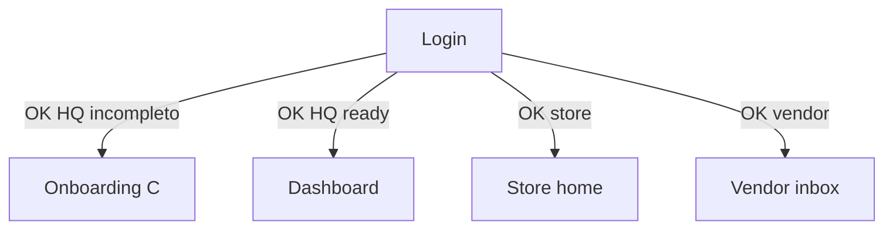
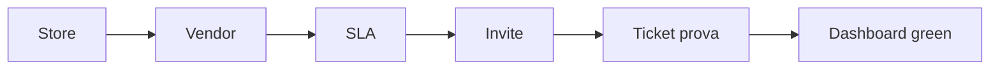
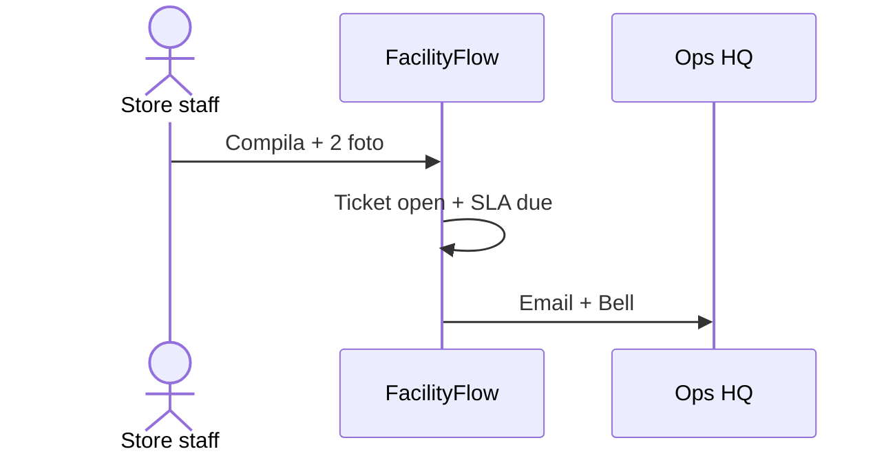
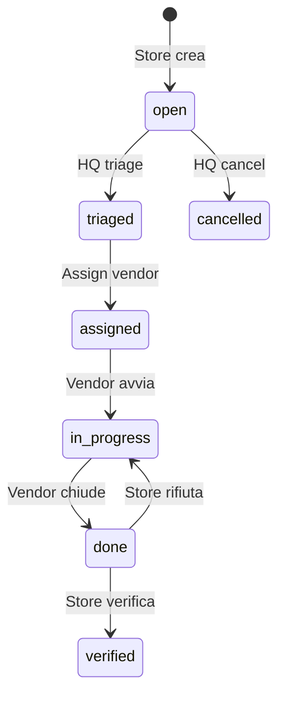
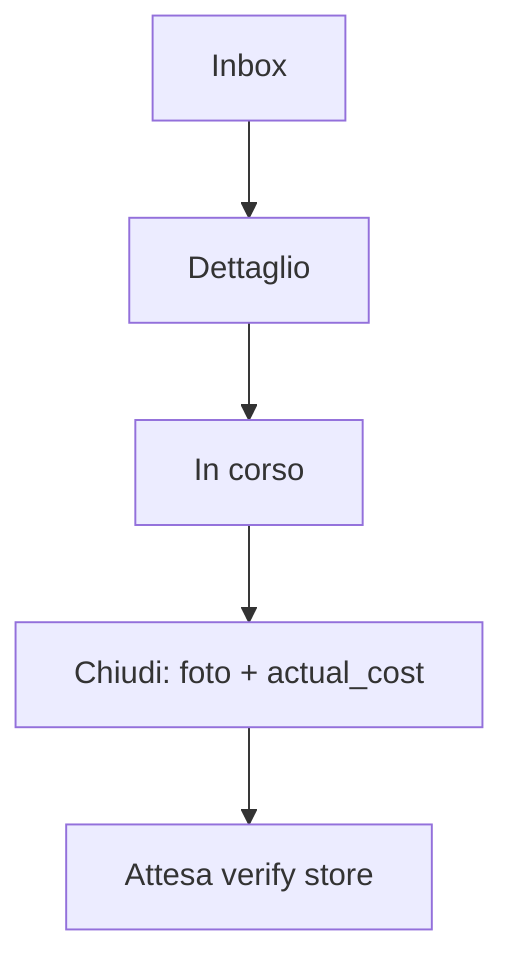
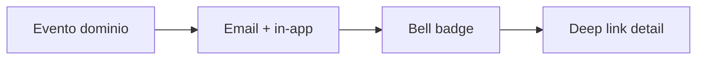
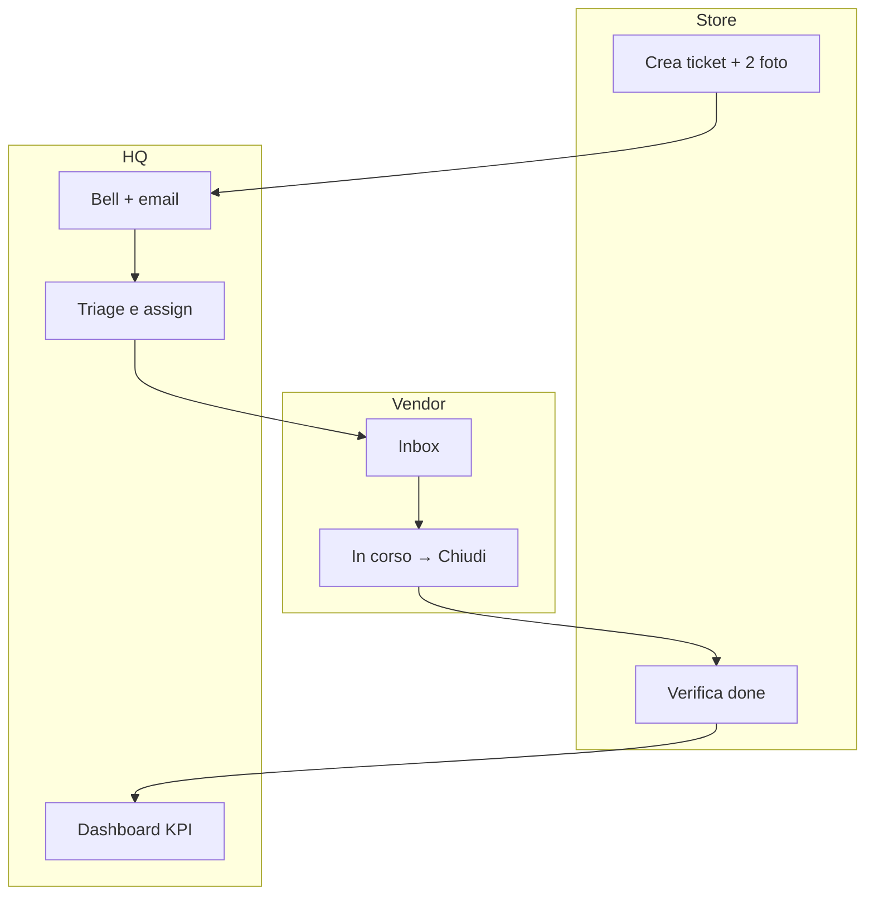
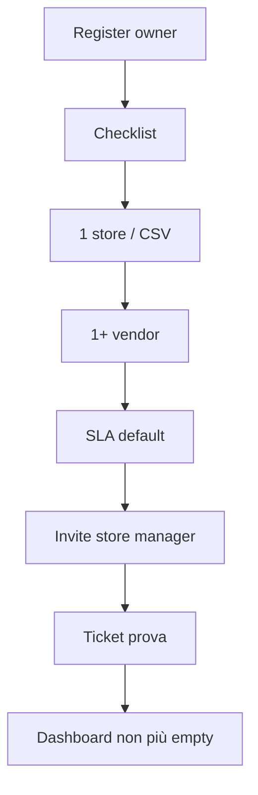

# FacilityFlow Retail — Wireframe (ASCII / Mermaid)

> Spec low-fidelity. Nessun codice React. Focus **Flusso A** (guasto critico) e **Flusso C** (onboarding &lt;15 min).  
> Token/visual: [`DESIGN_SYSTEM.md`](./DESIGN_SYSTEM.md) · Route: [`INFORMATION_ARCHITECTURE.md`](./INFORMATION_ARCHITECTURE.md)

**Convenzioni ASCII**

- `[====]` = CTA primaria  
- `( )` = radio / `(x)` checked  
- `[ ]` = checkbox  
- `···` = overflow menu  
- Larghezza store/vendor ≈ 390px; HQ ≈ desktop

---

### Analysis Card

- **Assunzioni:** brand FacilityFlow hero su login; card solo dove c’è interazione (azioni triage, chiusura vendor); Bell = popover HQ/top.
- **Ricerca:** shell SaaS 2026 su shadcn (sidebar + sheet) — [ui.shadcn.com](https://ui.shadcn.com/).
- **Scelta di design:** create-ticket lineare sticky-CTA; triage HQ split list/detail su desktop, stack su tablet.
- **AI:** no.
- **Rischi:** overcrowding detail HQ — max 1 colonna azioni sticky a destra.

---

## Indice schermate

| # | Wireframe | Flusso |
|---|-----------|--------|
| 1 | Login | Auth / brand |
| 2 | Onboarding checklist | **C** |
| 3 | Store — crea ticket (mobile) | **A** |
| 4 | HQ — lista + dettaglio triage | **A** |
| 5 | Vendor — inbox + chiudi job | **A** |
| 6 | Dashboard HQ | A/C |
| 7 | Bell (notifiche) | A/B |

---

## 1. Login — SCR-AUTH-01

Brand **FacilityFlow** a livello hero (non solo nav).

```
┌─────────────────────────────────────────────────────────────┐
│                                                             │
│   ░░░░░░░░░░░░░░░░░  full-bleed soft slate wash  ░░░░░░░   │
│                                                             │
│          FACILITYFLOW                                       │
│          (Sora display — hero)                              │
│                                                             │
│          Manutenzione retail, un solo sistema               │
│          di verità per store, HQ e fornitori.               │
│                                                             │
│          Email      [________________________]              │
│          Password   [________________________]              │
│                                                             │
│          [============  Accedi  ============]               │
│                                                             │
│          Password dimenticata? · Crea workspace             │
│                                                             │
└─────────────────────────────────────────────────────────────┘
```

**Note UX**

- Nessuna card attorno al form se il contrasto sullo sfondo basta; se serve contenitore → un solo pannello radius-md, non “card stack”.
- Errori sotto campo; lockout messaggio calmo IT.



---

## 2. Onboarding checklist — SCR-ONB-01 (Flusso C)

```
┌──────────────────────────────────────────────────────────────┐
│ FacilityFlow · Setup rete                         Salta ⚠   │
├──────────────────────────────────────────────────────────────┤
│  Completa la rete in meno di 15 minuti                      │
│  ████████░░░░░░░░  3/5                                      │
│                                                              │
│  ✓  1. Crea o importa punti vendita                         │
│  ✓  2. Aggiungi almeno un fornitore                         │
│  ✓  3. Imposta SLA predefinite                              │
│  ○  4. Invita store manager              [Continua →]       │
│  ○  5. Apri ticket di prova              (bloccato)         │
│                                                              │
│  Suggerimento: importa CSV se hai già l’anagrafica store.   │
└──────────────────────────────────────────────────────────────┘
```

**Skip:** dialog “Puoi riprendere dalla dashboard. Alcuni KPI resteranno vuoti.”



---

## 3. Store — crea ticket mobile — SCR-ST-02 (Flusso A start)

Target **390px**. Sticky CTA. No card decorative.

```
┌──────────────────────────┐
│ ←  Nuovo ticket     🔔 3 │
├──────────────────────────┤
│ Punto vendita            │
│ [ PV Milano Duomo    ▾ ] │
│                          │
│ Categoria *              │
│ [ Refrigerazione     ▾ ] │
│                          │
│ Priorità *               │
│ ( ) Bassa  ( ) Media     │
│ (•) Alta   ( ) Critica   │
│                          │
│ Asset (opzionale)        │
│ [ Frigo banco 2      ▾ ] │
│                          │
│ Descrizione *            │
│ ┌──────────────────────┐ │
│ │ Frigo banco 2 non    │ │
│ │ raffredda…           │ │
│ └──────────────────────┘ │
│                          │
│ Foto (max n)             │
│ [ + Scatta / Galleria ]  │
│ [img1] [img2]            │
│                          │
│                          │
│                          │
├──────────────────────────┤
│ [====  Apri ticket  ====]│  ← sticky
├──────────────────────────┤
│ Home  Ticket  ⊕  Account │
└──────────────────────────┘
```

**AC Flusso A:** 2 foto → `open` → notifica HQ.



---

## 4. HQ — lista + dettaglio triage — SCR-HQ-02 / 03 (Flusso A)

### 4.1 Desktop split

```
┌────────┬─────────────────────────────────────────────────────┐
│ FF     │ Ticket          Filtri: Stato▾ Store▾ SLA▾   🔔 1  │
│ ────── │─────────────────────────────────────────────────────│
│ Dash   │ ID     Store     Pri   SLA      Stato    Updated    │
│ Ticket │ T-104  MI-02    CRIT  3h 12m   Aperto   2 min  ←sel│
│ Store  │ T-103  RM-01    Alta  ok       Assegn.  1 h         │
│ Vendor │ T-102  MI-02    Med   BREACH   In corso 3 h         │
│ Asset  │                                                     │
│ Sett.  │─────────────────────────────────────────────────────│
│        │ T-104 · Frigo banco 2 non raffredda                 │
│        │ MI-02 · Critica · Aperto · SLA 4h (due 14:32)       │
│        │                                                     │
│        │ ┌ Azioni triage (unico blocco interazione) ───────┐ │
│        │ │ Priorità [Critica ▾]                            │ │
│        │ │ Vendor   [Refrigerazione Nord ▾] ← preferred ★  │ │
│        │ │ [==== Assegna ====]  [Salva triage]             │ │
│        │ └─────────────────────────────────────────────────┘ │
│        │                                                     │
│        │ Tab: Panoramica | Timeline | Note | Allegati | Costi│
│        │  · 2 foto                                           │
│        │  · Nota interna: …                                  │
└────────┴─────────────────────────────────────────────────────┘
```

### 4.2 Lista row — segnale SLA

```
| T-102 | MI-02 | Med | ■ BREACH | In corso | 3 h | ··· |
         bordo sinistro critical
```



---

## 5. Vendor — inbox + chiudi job — SCR-VN-01 / 02 (Flusso A)

### 5.1 Inbox mobile

```
┌──────────────────────────┐
│ FacilityFlow · Fornitore │
│ Inbox                 🔔 │
├──────────────────────────┤
│ Aperti (2)               │
│                          │
│ ┌──────────────────────┐ │  ← row tap = nav (non card marketing)
│ │ T-104 · Critica      │ │
│ │ MI-02 · SLA 3h 05m   │ │
│ │ Frigo banco 2…       │ │
│ └──────────────────────┘ │
│ ┌──────────────────────┐ │
│ │ T-099 · Alta         │ │
│ │ RM-01 · SLA ok       │ │
│ └──────────────────────┘ │
│                          │
├──────────────────────────┤
│ Inbox    Chiusi   Account│
└──────────────────────────┘
```

### 5.2 Dettaglio + chiusura

```
┌──────────────────────────┐
│ ← T-104                  │
│ Critica · MI-02          │
│ SLA scade 14:32          │
├──────────────────────────┤
│ Descrizione…             │
│ Allegati store: 2 foto   │
│                          │
│ Stato attuale: Assegnato │
│ [  Segna in corso     ]  │
│                          │
│ ── Chiudi intervento ──  │
│ Prove foto *             │
│ [ + Aggiungi foto ]      │
│ Costo effettivo (€) *    │
│ [ 185,00              ]  │
│ Nota vendor              │
│ [                     ]  │
├──────────────────────────┤
│ [== Chiudi e invia ==]   │  → status done
└──────────────────────────┘
```



---

## 6. Dashboard HQ — SCR-HQ-01

### 6.1 Post-onboarding (dati)

```
┌────────┬────────────────────────────────────────────────────┐
│ FF     │ Buongiorno, Ops                         🔔 0  User│
│ Dash ● │────────────────────────────────────────────────────│
│ Ticket │ Aperti  A rischio SLA  Breach  MTTR 7g  Costo 7g  │
│ …      │  12         3            1      5.2h    € 4.2k    │
│        │  (metric strip — click → lista filtrata; no nested │
│        │   card se non sono link)                           │
│        │────────────────────────────────────────────────────│
│        │ Ticket a rischio                    Vedi tutti →   │
│        │ T-104 MI-02 Critica  due 3h                        │
│        │ T-102 MI-02 Breach   ···                           │
│        │────────────────────────────────────────────────────│
│        │ Volume 7 giorni (chart Tremor/Recharts)            │
│        │ ▁▂▃▅▄▆▄                                            │
└────────┴────────────────────────────────────────────────────┘
```

### 6.2 Empty (Flusso C non finito)

```
│  La rete non è ancora pronta.                               │
│  Completa l’onboarding per vedere i KPI.                    │
│  [==== Continua onboarding ====]                            │
```

---

## 7. Bell — SCR-NT-01

Popover dalla topbar (HQ / store / vendor). Max ~6 preview + “Vedi tutte”.

```
┌─────────────────────────────┐
│ Notifiche            Segna ✓│
├─────────────────────────────┤
│ ● Nuovo ticket T-104        │
│   MI-02 · Critica · 2 min   │
│                             │
│ ○ Ticket T-102 — SLA breach │
│   1 h fa                    │
│                             │
│ ○ Assegnato T-090           │
│   (es. vendor view)         │
├─────────────────────────────┤
│ Vedi tutte                  │
└─────────────────────────────┘
```

**Motion:** badge count pulse **una volta** all’incremento (`motion`, rispetta reduced-motion).

**Tap:** deep-link a ticket (IA §9). Breach evidenziato con testo + icona, non solo colore.



---

## 8. Flusso A — storyboard end-to-end



---

## 9. Flusso C — storyboard &lt;15 min



---

## 10. Criteri di accettazione wireframe → UI

- [ ] Login: wordmark FacilityFlow ≥ display scale; claim 1 riga  
- [ ] Onboarding: progress + 5 step; skip con warning  
- [ ] Create ticket usabile a 390px con CTA sticky  
- [ ] HQ: filtri + assign vendor in &lt;3 click da notifica  
- [ ] Vendor: chiusura richiede foto + `actual_cost`  
- [ ] Dashboard empty → onboarding; filled → metric strip  
- [ ] Bell: unread + deep-link; no emoji  

---

## Riferimenti

- [`DESIGN_SYSTEM.md`](./DESIGN_SYSTEM.md)  
- [`INFORMATION_ARCHITECTURE.md`](./INFORMATION_ARCHITECTURE.md)  
- Backlog E13 Flussi A/C: [`../product/BACKLOG.md`](../product/BACKLOG.md)  
